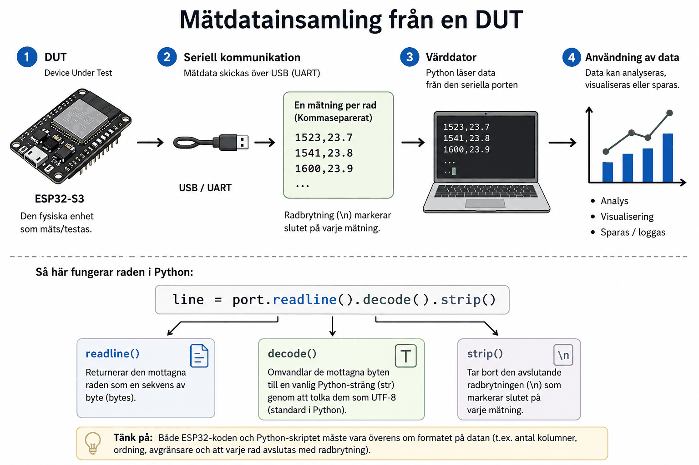

# Bilaga A - Insamling och lagring av mätdata



## DUT: Device Under Test
En **DUT** är den fysiska enhet som testas eller mäts, i vårt fall er `ESP32-S3`. Till skillnad
från enhets- och komponenttester, som körs på värddatorn utan hårdvara, handlar
mätdatainsamling om att faktiskt hämta ut data från den riktiga, körande produkten.

Kedjan består av tre steg, som tillsammans utgör G-kravet
[Mätdatainsamling och automatiserade integrationstester](../../../projects/P04/README.md#mätdatainsamling-och-automatiserade-integrationstester-g)
i **P04**:
1. **Insamling:** `ESP32-S3` skickar mätvärden över seriell kommunikation, och ett Python-skript
   läser dem på värddatorn (den här lektionen).
2. **Lagring:** skriptet sparar mätvärdena strukturerat, t.ex. som CSV (den här lektionen).
3. **Processning och visualisering:** mätdatan bearbetas, ritas upp och jämförs mot systemets
   kravställning (**L17**).

---

## Insamling: ett enkelt, väldefinierat protokoll
För att värddatorn ska kunna tolka data som skickas över seriell kommunikation krävs ett
väldefinierat format, känt av båda sidor i förväg. Ett enkelt och vanligt val är
kommaseparerade rader, en mätning per rad, avslutad med radbrytning:

```
1523,612,23.7
1541,614,23.8
1600,615,23.9
```

Formatet i sig känner inte till vad kolumnerna betyder; det är en överenskommelse mellan den som
skriver `ESP32`-firmwaren och den som skriver Python-skriptet. Skriv därför ner protokollet, t.ex.
i ert repos `README.md`: vilka fält varje rad innehåller, i vilken ordning och med vilken enhet.

### Firmware-sidan
Er firmware från **P02** skriver redan ut text via `driver::serial::Interface`, t.ex. som svar på
`"temp"`. Det finns två vanliga sätt att få ut en serie mätvärden ur den:
* **Fråga-svar:** Python-skriptet skickar `"temp"` med jämna mellanrum och läser svaret. Det
  kräver ingen ändring i firmwaren, men tidsstämpeln sätts då av värddatorn, inte av DUT:en.
* **Strömmande:** ett nytt kommando, t.ex. `"log on"`/`"log off"`, får `system::logic::Logic` att
  skriva ut en mätrad i protokollets format vid varje timeravbrott. Tidsstämpeln sätts då av
  DUT:en själv, vilket ger en mer exakt tidsaxel.

Lägger ni till ett kommando i `Logic` är det ny produktionskod, och den ska ha komponenttester
precis som de befintliga kommandona (se **L11**).

### Python-sidan
En kort läsning av sådana rader i Python med `pyserial` kan se ut så här:

```python
import serial

with serial.Serial("/dev/ttyUSB0", baudrate=115200, timeout=1) as port:
    while True:
        line = port.readline().decode().strip()
        if line:
            print(line)
```

**Noteringar:**
* `readline()` returnerar de mottagna tecknen som en sekvens av bytes.
* `decode()` omvandlar byten till en vanlig Python-sträng (`str`) genom att tolka dem som UTF-8.
* `strip()` tar bort den avslutande radbrytningen (`\n`) som markerar slutet på varje mätning.
* `timeout=1` gör att `readline()` ger upp efter en sekund och returnerar en tom sträng, i
  stället för att vänta för evigt på en DUT som inte svarar.

Namnet på porten skiljer sig mellan datorer: `/dev/ttyUSB0` eller `/dev/ttyACM0` i Linux, `COM3`
eller liknande i Windows. Hårdkoda det inte, utan ta emot det som ett argument till skriptet, t.ex.
via `argparse`.

### Trasiga rader
Bestäm i förväg hur skriptet ska hantera en rad som är trasig eller ofullständig, t.ex. på grund
av brus på linjen, en rad som kommer mitt i en annan utskrift, eller den halva rad som ofta tas
emot precis när porten öppnas: hoppas den över tyst, loggas den som en varning, eller avbryts
insamlingen? Ett rimligt förval är att validera varje rad (rätt antal fält, alla fält går att tolka
som tal) och att räkna och logga de rader som inte klarar valideringen:

```python
def parse_line(line: str, field_count: int) -> list[float] | None:
    """Parse a comma-separated measurement line, or return None if the line is invalid."""
    fields = line.split(",")
    if len(fields) != field_count:
        return None
    try:
        return [float(field) for field in fields]
    except ValueError:
        return None
```

Att ett antal rader kasserades är i sig ett mätresultat. Är det en rad av tusen är det brus; är
det var tionde rad är något fel i protokollet eller i firmwaren.

---

## Lagring: CSV med kolumnrubriker
Rådata som bara skrivs ut i en terminal försvinner så fort fönstret stängs. Spara den i stället
som en CSV-fil med tydliga kolumnrubriker, inklusive enhet, så blir filen självförklarande och
går att bearbeta i efterhand:

```
timestamp_ms,adc_raw,temperature_c
1523,612,23.7
1541,614,23.8
1600,615,23.9
```

Python-modulen `csv` sköter formatet åt er:

```python
import csv

with open("measurements.csv", "w", newline="") as file:
    writer = csv.writer(file)
    writer.writerow(["timestamp_ms", "adc_raw", "temperature_c"])
    writer.writerow([1523, 612, 23.7])
```

Några principer som gör mätdatan användbar även långt efteråt:
* **Spara rådatan, och processa en kopia.** Ett glidande medelvärde kan jämna ut brus, men samma
  utjämning kan även dölja ett verkligt problem. Har ni bara den processade datan kvar går det
  inte att avgöra vilket det var.
* **En fil per mätning**, med datum och tid i filnamnet, t.ex.
  `temperature_2027-01-20_1015.csv`. Då skriver en ny mätning aldrig över en gammal.
* **Dokumentera förutsättningarna**: vilken firmware (commit), vilket kort och vilka
  omgivningsförhållanden mätningen gjordes under. Utan det går en mätning inte att upprepa eller
  jämföra med en senare.

---
